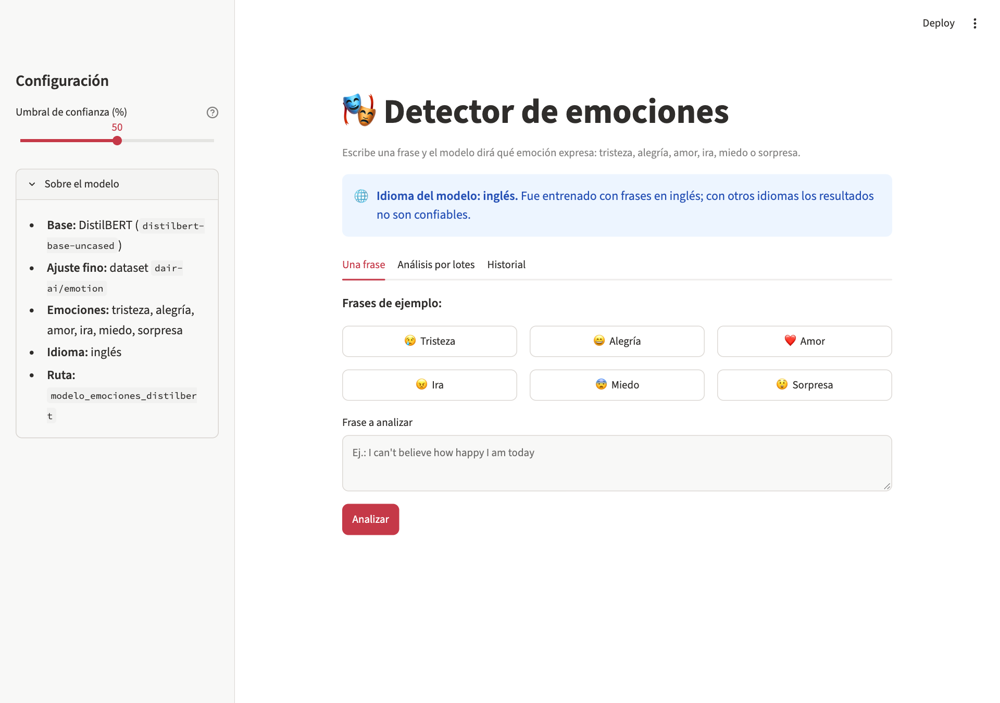
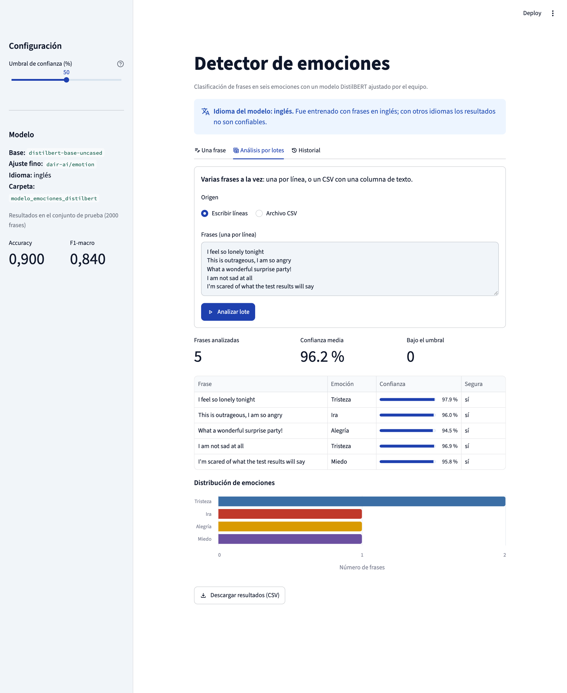
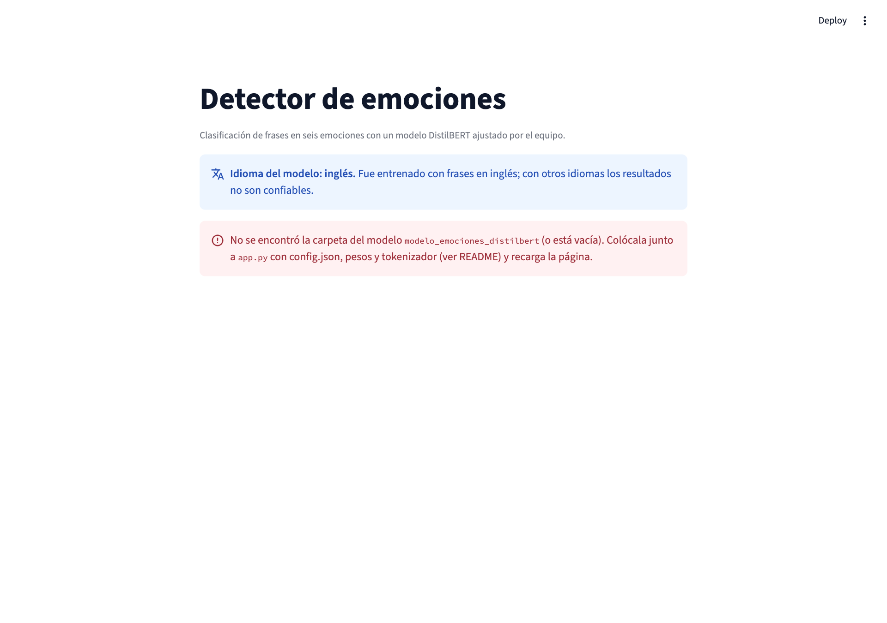

# 🎭 Detector de emociones con DistilBERT + Streamlit

Aplicación web que recibe una frase en **inglés** y devuelve la emoción que expresa (tristeza, alegría, amor, ira, miedo o sorpresa), la confianza del modelo y un gráfico con las probabilidades de las seis emociones.

**Integrantes:** Carlos Ortega y Juan Esteban Vivero
**Materia:** Análisis, Procesamiento y Aplicación de IA — clase «Fine-tuning y evaluación de modelos de lenguaje»



## Modelo

- **Base:** `distilbert-base-uncased`, ajustado por el equipo en el notebook de clase (Bloque 4.4) con el dataset `dair-ai/emotion` (tuits cortos en inglés).
- **Entrenamiento:** 4000 frases de entrenamiento, 3 épocas, `learning_rate=2e-5`, `max_length=64`, semilla 42 (los mismos valores están en `entrenar_modelo.py`).
- **Etiquetas** (`id2label` en `config.json`): 0 tristeza, 1 alegría, 2 amor, 3 ira, 4 miedo, 5 sorpresa.
- **Idioma de entrenamiento: inglés.** La app lo indica siempre y además avisa si la frase parece estar en español.
- **Resultados en el conjunto de prueba** (2000 frases, medidos con este mismo modelo): **accuracy 0,900** y **F1-macro 0,840**.

| Emoción | Precisión | Recall | F1 | Frases en prueba |
|---|---|---|---|---|
| tristeza | 0,933 | 0,957 | 0,945 | 581 |
| alegría | 0,901 | 0,944 | 0,922 | 695 |
| amor | 0,794 | 0,704 | 0,747 | 159 |
| ira | 0,922 | 0,862 | 0,891 | 275 |
| miedo | 0,871 | 0,906 | 0,888 | 224 |
| sorpresa | 0,800 | 0,545 | 0,649 | 66 |

- La carpeta `modelo_emociones_distilbert/` pesa ~256 MB (el archivo `model.safetensors` solo ya mide 268 MB) y **no se sube a GitHub** porque GitHub no acepta archivos de más de 100 MB. Está excluida en `.gitignore`.
- Si no tienes la carpeta, `entrenar_modelo.py` reproduce el Bloque 4 del notebook y la genera (en Colab con GPU tarda unos minutos).

## Instalación y ejecución

Requisitos: Python 3.10 o superior (probado con Python 3.14, Streamlit 1.67, Transformers 5.22, PyTorch 2.15).

```bash
git clone <url-del-repositorio>
cd <carpeta-del-repositorio>
pip install -r requirements.txt
```

Copia la carpeta `modelo_emociones_distilbert/` junto a `app.py` (debe contener `config.json`, `model.safetensors`, `tokenizer.json` y `tokenizer_config.json`). Luego:

```bash
streamlit run app.py
```

La app se abre en `http://localhost:8501`.

Prueba automática (opcional): `python probar_app.py app.py` abre la app sin navegador, analiza una frase vacía, una en inglés, una en español, un ejemplo y un lote, e imprime los resultados.

Estructura:

```
proyecto/
├── app.py                         aplicación Streamlit
├── requirements.txt               dependencias
├── README.md
├── .gitignore                     excluye la carpeta del modelo
├── entrenar_modelo.py             regenera el modelo si no lo tienes
├── probar_app.py                  prueba automática de app.py
├── capturas/                      capturas de pantalla del README
└── modelo_emociones_distilbert/   (no se sube a GitHub)
```

## Funcionalidades

**Obligatorias**
- Campo de texto y botón **Analizar**.
- Emoción detectada (con emoji) y confianza en porcentaje.
- Gráfico de barras con las seis emociones, ordenado de mayor a menor y con el porcentaje en cada barra; la emoción ganadora se resalta en otro color.
- Modelo cargado una sola vez con `@st.cache_resource` (Streamlit lo reutiliza en cada interacción).
- Validaciones: aviso si la frase está vacía (o solo tiene espacios); mensaje de error si la carpeta del modelo no existe o está vacía; si la carpeta existe pero el modelo está dañado, se muestra el error sin que la app se caiga.
- Frases largas: se usa `truncation=True`, así que el texto se corta a 512 tokens (probado con una frase de ~3000 palabras: no falla).
- Aviso del idioma del modelo (inglés) y advertencia extra si la frase parece estar en español.

**Adicionales implementadas (4)**
1. **Umbral de confianza:** control deslizante en la barra lateral (50 % por defecto); si la emoción principal queda por debajo, aparece una advertencia.
2. **Análisis por lotes:** una frase por línea o un archivo CSV (se elige la columna de texto); tabla con emoción, confianza y si supera el umbral, gráfico de distribución y botón para descargar los resultados en CSV.
3. **Historial:** las frases analizadas en la sesión se guardan con `st.session_state` y se pueden borrar.
4. **Frases de ejemplo:** seis botones, uno por emoción, que cargan una frase de prueba en el campo de texto.

## Capturas de pantalla

| | |
|---|---|
| **Resultado con gráfico** (ejemplo de sorpresa)  | **Aviso de baja confianza** (41,1 % < umbral de 50 %)  |
| **Aviso de frase en español**  | **Análisis por lotes**  |
| **Historial de la sesión**  | **Error: carpeta del modelo ausente**  |

## Análisis de errores

En el conjunto de prueba el modelo acierta el 90 % de las frases, pero el F1-macro baja a 0,840 porque falla más en las clases pequeñas. Todos los números de esta sección salen de ejecutar nuestro modelo (emoción principal y las dos siguientes).

| Frase | Predicción (top 3) | ¿Correcto? |
|---|---|---|
| I am not sad at all | tristeza 96,9 %, alegría 0,9 %, miedo 0,7 % | ✗ negación |
| I don't hate you | ira 59,6 %, tristeza 34,0 %, amor 3,0 % | ✗ negación |
| Oh great, another Monday. I'm just thrilled | alegría 93,5 %, sorpresa 2,9 %, amor 1,6 % | ✗ sarcasmo |
| I can't believe what just happened | miedo 41,1 %, sorpresa 35,9 %, alegría 7,8 % | dudoso (debería ser sorpresa) |
| I'm happy for her but I will miss her terribly | alegría 60,1 %, tristeza 30,4 %, amor 6,4 % | parcial (mezcla) |
| I can't believe it, I won the lottery! | alegría 85,3 %, sorpresa 4,1 %, ira 3,0 % | parcial (falta sorpresa) |
| Estoy muy feliz porque aprobé el examen | alegría 87,2 %, tristeza 2,8 %, miedo 2,8 % | ✓ por casualidad |
| Tengo mucho miedo de quedarme solo | alegría 73,6 %, amor 10,4 %, tristeza 5,4 % | ✗ español |
| Te odio, me mentiste otra vez | alegría 67,8 %, amor 15,5 %, tristeza 7,9 % | ✗ español |

**1. Negación.** El modelo reacciona a palabras clave («sad», «hate») y no entiende que «not» o «don't» las invierten: «I am not sad at all» sale tristeza con 96,9 % de confianza. En los tuits de entrenamiento casi nunca aparece la palabra emocional negada, así que el modelo no aprendió ese patrón.

**2. Sarcasmo.** «Oh great, another Monday. I'm just thrilled» sale alegría con 93,5 %. Las palabras son positivas y el sentido negativo depende del contexto («another Monday») y del tono, que un clasificador entrenado con frases literales no capta. Lo más peligroso es que se equivoca **con mucha confianza**, así que el umbral no lo detecta.

**3. Emociones mezcladas.** El modelo solo puede elegir una emoción. En «I'm happy for her but I will miss her terribly» reparte la probabilidad (alegría 60,1 % y tristeza 30,4 %): el gráfico de barras sí muestra la mezcla, pero la etiqueta principal oculta la mitad del mensaje.

**4. Clases vecinas.** En la matriz de confusión de prueba, 42 de las 159 frases de **amor** se clasificaron como alegría y 26 de alegría como amor: ambas usan vocabulario positivo parecido. Con **sorpresa** pasa algo similar: de 66 frases solo acierta 36 (recall 0,545); 14 se van a miedo y 12 a alegría. Por eso «I can't believe what just happened» queda casi empatada entre miedo (41,1 %) y sorpresa (35,9 %), y «I won the lottery!» sale alegría en vez de sorpresa.

**5. Clases minoritarias.** En el conjunto de prueba hay 695 frases de alegría y 581 de tristeza, pero solo 159 de amor y 66 de sorpresa. En las 4000 frases con las que entrenamos pasa lo mismo: 1341 de alegría y 1160 de tristeza frente a solo 313 de amor y 144 de sorpresa. Con tan pocos ejemplos, amor (F1 0,747) y sorpresa (F1 0,649) son justo las emociones con peores resultados.

**6. Español.** El modelo y su tokenizador (`uncased`, vocabulario inglés) solo vieron inglés. «Tengo mucho miedo de quedarme solo» sale alegría (73,6 %) y «Te odio, me mentiste otra vez» también alegría (67,8 %). La frase «Estoy muy feliz…» acierta, pero es casualidad: el modelo tiende a responder alegría ante texto que no entiende. Por eso la app avisa cuando detecta español.

**7. Errores con mucha confianza en el dataset.** Entre los 10 errores de prueba con mayor confianza (todos entre 96 % y 98 %), varios parecen **etiquetas discutibles del propio dataset**: «i feel underappreciated and under valued» está etiquetada como alegría y el modelo dice tristeza (96,6 %); «i feel very saddened that the king…» está etiquetada como alegría y el modelo dice tristeza (97,8 %). Otros son frases largas con varias emociones, donde una palabra fuerte domina («the depth of sorrow that i feel…», etiquetada sorpresa, predicha tristeza con 96,3 %). Es decir, parte del 10 % de error no es culpa del modelo sino de etiquetas ruidosas.

**Conclusión:** el modelo funciona bien con frases directas en inglés, pero se apoya mucho en palabras clave. Falla con negaciones, sarcasmo, mezclas de emociones, las clases con pocos ejemplos (amor y sorpresa) y cualquier idioma distinto del inglés. Para mejorarlo se podría entrenar con todo el dataset (16 000 frases en vez de 4000), balancear las clases o usar un modelo multilingüe.

## Declaración de uso de IA

- **Herramientas usadas:** Claude (Anthropic), mediante Claude Code.
- **Para qué partes del proyecto:** escribir y corregir `app.py`, `requirements.txt` y `.gitignore`, hacer las pruebas de la app, el análisis de errores con nuestro modelo, las capturas de pantalla y este README.
- **Qué verificamos o modificamos nosotros:** el modelo lo entrenamos nosotros en el notebook de clase. Revisamos el código línea por línea para poder explicarlo, ejecutamos la app con nuestro modelo y comprobamos que los resultados del análisis de errores coincidieran con lo que muestra la app.
